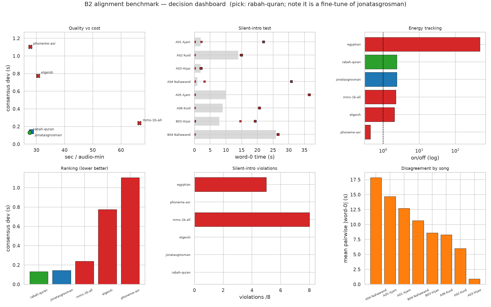

# B2 Findings — word-level forced alignment on real YuE2 renders

**Verdict: pick `rabah2026/wav2vec2-large-xlsr-53-arabic-quran-v_final`.**
It tops the cross-model consensus *and* survives the decisive silent-intro test,
at baseline cost. `jonatasgrosman/...-arabic` is a statistically tied fallback.

Date 2026-10-15. Run on this CPU-only box (see *Environment* below). Harness:
`scripts/bench.py`; metrics/decision rule: [docs/BENCH-PLAN.md](../docs/BENCH-PLAN.md).
Raw data: `bench_raw.jsonl`, `bench_results.json`, full log `bench.log`.

## Setup

| | |
|---|---|
| Audio | 8 real YuE2 renders, GCS `arabmaqamrock/runs/20261014-093128_batch_02_formatted` |
| Songs | 2 per maqam: Ajam (2 poems), Kurd (2 poems), Hijaz (1 poem × A/B takes), Nahawand (1 poem × A/B takes) |
| Lyrics | render `prompts/<name>_lyrics.txt`, wrapped in the harness `[Lyrics]` caption format |
| Separation | Demucs `htdemucs --two-stems=vocals`, CPU, **cached** (8 stems, ~100–130 s each) |
| Align | `torchaudio.functional.forced_align`, 6 CTC models, one at a time |
| Command | `python scripts/bench.py --models bench/models.txt --auto-songs --data-dir data/yue2_songs --out results/bench --device cpu --sep-device cpu` |

> Caveat on the song set: the batch has only one poem per **Hijaz**/**Nahawand**,
> so for those two maqams the second track is a different delivery condition
> (A "precise diction" vs B "crisp consonants") of the *same* poem, not a second
> poem. Ajam/Kurd use two distinct poems.

## Figures

Decision dashboard and per-issue plots live in `bench/plots/`; rebuild them
from the saved results with `.venv/bin/python scripts/bench_plots.py`.

- `01_pareto.png` — quality vs cost (bubble = params); rabah and
  jonatasgrosman share the best-quality / lowest-cost corner.
- `02_silent_intro.png` — the decisive test: word 0 vs measured lead silence.
- `03_energy.png` — on/off energy tracking (log); phoneme falls below 1.
- `04_trap_metric.png` — MMS's best-in-class coverage beside its 8/8 intro
  violations.
- `05_lineage.png` — rabah-quran vs its own base; ≤0.04 s apart every song, so
  their "consensus" is self-agreement.
- `06_song_difficulty.png` — disagreement by song (Nahawand dominates).

## Model table (all 6 loaded; no load failures)

| model | ok/total | consensus dev (s) | on/off | coverage | mono | translit | sec/audio-min | params (M) | peak mem |
|---|---|---|---|---|---|---|---|---|---|
| `rabah2026/wav2vec2-large-xlsr-53-arabic-quran-v_final` | 8/8 | **0.133** | 2.39 | 0.96 | 100% | none | 27.6 | 316 | 1341 MB |
| `jonatasgrosman/wav2vec2-large-xlsr-53-arabic` | 8/8 | 0.143 | 2.37 | 0.97 | 100% | none | 28.2 | 316 | 1816 MB |
| `facebook/mms-1b-all` | 8/8 | 0.240 | 2.25 | 1.00 | 100% | none | 66.5 | 965 | −1203 MB¹ |
| `elgeish/wav2vec2-large-xlsr-53-arabic` | 8/8 | 0.776 | 2.04 | 0.95 | 100% | buckwalter | 30.6 | 316 | 1348 MB |
| `MostafaMaroof/wav2vec2-arabic-phoneme-asr` | 8/8 | 1.104 | **0.44** | 0.96 | 100% | buckwalter | 27.8 | 316 | 1274 MB |
| `IbrahimAmin/egyptian-arabic-wav2vec2-xlsr-53` | 8/8² | — | 479.22 | 0.97 | 100% | none | 27.1 | 316 | 1330 MB |

¹ CPU peak-mem column is an RSS *delta* measured after the previous model was
freed, so it is noisy and can go negative (MMS). Treat **params** and
**sec/audio-min** as the efficiency axes, not this column.
² Loaded fine but produced **1 word per song** (see failures).

Consensus dev = mean over songs of the per-song median `|dstart|` to the other
models (lower is better). It is a *proxy*; a shared bias is invisible to it,
which is why the silent-intro test below decides the tie.

## The decisive test — did any word land in the silent intro?

Method: measure the vocal stem's leading silence independently (first second
window whose RMS ≥ 0.01), then check where each model put **word 0**. A real
aligner must wait for the voice.

| song | stem lead-silence | rabah | jonatasgrosman | elgeish | phoneme | **mms-1b** | egyptian |
|---|---|---|---|---|---|---|---|
| A_01 Ajam | 2 s | 21.9 | 21.9 | 21.9 | 2.2 | **0.04 ✗** | 0.0 ✗ |
| A_02 Kurd | 14 s | 14.9 | 14.9 | 14.9 | 14.8 | **0.0 ✗** | 14.9 |
| A_03 Hijaz | 2 s | 2.1 | 2.1 | 2.1 | 1.9 | **0.0 ✗** | 0.0 ✗ |
| A_04 Nahawand | 1 s | 30.8 | 30.8 | 30.8 | 3.2 ⚠ | **0.0 ✗** | 0.0 ✗ |
| A_05 Ajam | 10 s | 36.5 | 36.6 | 36.5 | 36.3 | **0.0 ✗** | 0.0 ✗ |
| A_06 Kurd | 9 s | 20.7 | 20.7 | 20.7 | 20.5 | **0.0 ✗** | 20.7 |
| B_03 Hijaz | 8 s | 19.3 | 19.3 | 19.3 | 14.5 ⚠ | **0.08 ✗** | 0.0 ✗ |
| B_04 Nahawand | 26 s | 26.6 | 26.6 | 26.6 | 26.5 | **0.0 ✗** | 26.6 |

**Leading-silence violations (word 0 inside measured silence):**

| model | violations |
|---|---|
| rabah2026-quran | **0/8** |
| jonatasgrosman | **0/8** |
| elgeish | **0/8** |
| MostafaMaroof-phoneme | 0/8 (but see below) |
| `facebook/mms-1b-all` | **8/8 — FAILS** |
| IbrahimAmin-egyptian | 5/8 (and 1 word/song) |

The three script models agree on word 0 to **≤0.02 s on every song**. MMS-1b
starts at ~0 on *all eight* songs — it smears content into the instrumental
intro. Note this is invisible in the aggregate table: MMS has the **best
coverage (1.000)** and a **good consensus (0.240 s)**. Only the silent-intro test
catches it, exactly as BENCH-PLAN §1.2 predicted.

## Failures

**No model failed to load.** Two loaded but did not produce usable alignments:

1. **`IbrahimAmin/egyptian-arabic-wav2vec2-xlsr-53` — collapsed to 1 word/song.**
   All 8 songs returned `n_words_aligned = 1` (vocab 43, no diacritics, no
   transliteration). Same class of failure as the A0 bug: its tokenizer has no
   `|` word separator, so the whole target collapses to one span (coverage ≈ full
   song, hence the absurd on/off = 479). Excluded from consensus automatically
   (word counts don't match). Not usable for word-level output.
2. **`MostafaMaroof/wav2vec2-arabic-phoneme-asr` — fails energy tracking.**
   on/off = **0.19–0.62** on every song (all < 1): its word spans sit on
   *lower*-energy regions than the gaps — the opposite of alignment. It also
   diverges from the cluster's word 0 on 3 songs (⚠ above). Phoneme vocab (80),
   Buckwalter path. Consensus 1.104 s (worst of the ones measured).

## Per-song difficulty (mean pairwise `|dstart|`, all measured models)

| song | maqam | mean pairwise (s) |
|---|---|---|
| `A_04 ...القطا-ومضجع-العراء` | Nahawand | **2.244** |
| `B_04 ...القطا-ومضجع-العراء` | Nahawand | **2.146** |
| `A_06 ...ليلة-الرعب` | Kurd | 0.648 |
| `A_01 ...الوداع...` | Ajam | 0.342 |
| `A_03 ...مشهد-الذئاب` | Hijaz | 0.214 |
| `A_02 ...تنزه...` | Kurd | 0.204 |
| `B_03 ...مشهد-الذئاب` | Hijaz | 0.204 |
| `A_05 ...الطريد...` | Ajam | 0.142 |

The **Nahawand poem dominates the disagreement** — and it is the one song where
the phoneme model and MMS both scatter (word 0 at 3.2 s / 0.0 s vs the cluster's
30.8 s). The per-song numbers are inflated by those two failing models; among the
three survivors, word-0 agreement is ~0.02 s everywhere, so this table says
**song choice matters more than model choice on the Nahawand piece**, not that
the surviving models disagree there.

## Ranking and decision (BENCH-PLAN §7)

1. No gold MAE → rank by cross-model consensus.
2. Mechanical gates: every model is 100% monotone and coverage ≥0.95, so none
   is filtered by the letter of §7.2. Then apply the decisive checks and drop
   **MMS-1b** (silent-intro 8/8), **phoneme** (on/off < 1) and **IbrahimAmin**
   (1 word/song). Survivors: rabah, jonatasgrosman, elgeish (silent-intro 0/8).
3. Top cluster within ~0.05 s of the best: **rabah 0.133 s** and
   **jonatasgrosman 0.143 s** (Δ = 0.010 s, less than one 20 ms frame). Pick the
   cheaper: both 316 M; rabah is faster (**27.6** vs 28.2 s/min) and lighter
   (**1341** vs 1816 MB).
4. Tie-break integration: both take Arabic script directly (`translit=none`),
   same dependency footprint. No edge to jonatasgrosman.

**Choice: `rabah2026/wav2vec2-large-xlsr-53-arabic-quran-v_final`.**
The hypothesis in BENCH-PLAN §3 is *supported but not decisive*: the
Quran-trained model edges the generic baseline by ~10 ms of median agreement and
slightly better energy tracking, at equal or lower cost.

- **Safe fallback:** `jonatasgrosman/wav2vec2-large-xlsr-53-arabic` — the
  A0-proven baseline; statistically tied here.
- **Do not use on this data:** `facebook/mms-1b-all` (intro smear + 2.4× cost),
  `MostafaMaroof/...-phoneme-asr`, `IbrahimAmin/...` (broken),
  `elgeish/...` (0.776 s consensus and a fragile Buckwalter dependency — it
  matched the baseline on the clean Suno proxy in A0, but not on our renders).

## Harness bugs fixed this run

1. `bench.py:resolve_songs` — `--auto-songs` returned bare filenames opened
   relative to **CWD**, not `--data-dir` (Demucs wrote a corrupt stem; captions
   404'd). Now resolves against `data_dir`.
2. `bench.py:write_reports` — crashed on a single-model run (mean of an empty
   consensus list). Now prints `—`.
3. `a0_align.py:load_model` — `facebook/mms-1b-all` needs an explicit
   `set_target_lang("ara")` + `load_adapter("ara")`; without it the wrong
   language adapter is used silently.

## Caveats / next

- Consensus is a proxy and the top two are within noise; confirm by ear or with
  `--gold` anchors before committing.
- Word lists are not persisted by the harness, so the per-song difficulty table
  cannot be recomputed post-hoc excluding the failing models. If that matters,
  persist `word_lists` (small change).
- CPU peak-mem (RSS delta) is unreliable; if VRAM matters, re-run on a GPU box
  with `--device cuda` — the quality ranking should not change.
- `B4` (gold anchors / one non-CTC family) was out of scope for this run.

## Addendum (2026-10-15) — final decision: the **base** mirror

The verdict above picked `rabah2026-...-quran-v_final` on a **cost tie-break**.
A follow-up 2-song duel of the two self-hosted mirrors (`results/duel/`, run on
CPU) shows that tie-break is **noise**, so the pick is superseded.

Duel table (2 songs, `--limit-songs 2`):

| model | words | cover | on/off | intro-viol | s/audio-min | mem |
|---|---|---|---|---|---|---|
| `akbargherbal/...-arabic-quran-v_final` | 155/155, 161/161 | 0.950 | 2.02 | 0/2 | 32.5 | 1756 MB |
| `akbargherbal/...-arabic` (base) | 155/155, 161/161 | 0.950 | 2.21 | 0/2 | 30.1 | 1264 MB |

Word 0 landed **0.020 s apart on both songs — exactly one CTC frame** → explicit
TIE. And every tie-break axis **flipped** between this run and the 8-song sweep:

| axis | 8-song | 2-song duel |
|---|---|---|
| on/off | quran 2.39 > 2.37 | base 2.21 > 2.02 |
| s/audio-min | quran 27.6 < 28.2 | base 30.1 < 32.5 |
| peak mem | quran 1341 < 1816 | base 1264 < 1756 |

> A tie-break that reverses every run is not a tie-break. Accuracy is a genuine
> tie (both pass the silent-intro test; timings identical within a frame).

**Decision:** use **`akbargherbal/wav2vec2-large-xlsr-53-arabic`** (the base
mirror, pinned `4ca1c9c6ac85d839eebc530ec85b6a89f697e4e8`) as the production
aligner; keep the Quran mirror as a spare. The base is the ancestor checkpoint,
the more standard/better-exercised of the two, and the Quran fine-tune showed no
measurable benefit on our task.

Note: the two are the **same lineage** (rabah = a fine-tune of jonatasgrosman),
so "consensus" between them is self-agreement, and the whole bench's domain
labels were poor predictors — `egyptian` (dialectal) collapsed, `phoneme-asr`
failed energy tracking, `quran` matched its base, and only the plain baseline
scored. Only **gold anchors** (hand-checked word starts) can overturn this.

## A1 consumes this decision (2026-10-21)

`scripts/a1_align_run.py` now uses the base mirror and pinned revision above as
its default, and turns a run directory into word JSON + line-level VTT/SRT +
player + QA report. A smoke run on the A0a Suno track reproduced that trial's
first word at **21.481 s** (A0a: 21.48 s), 120/120 words, 24 line cues, coverage
0.971, on/off 2.15, silent-intro ok. Artifacts: `results/a1/suno-smoke/`;
protocol: [docs/A1-RUNBOOK.md](../docs/A1-RUNBOOK.md).

The model tie remains a tie: A1 does not create a gold set. If accuracy matters
enough to overturn the decision, hand-check anchors first.
